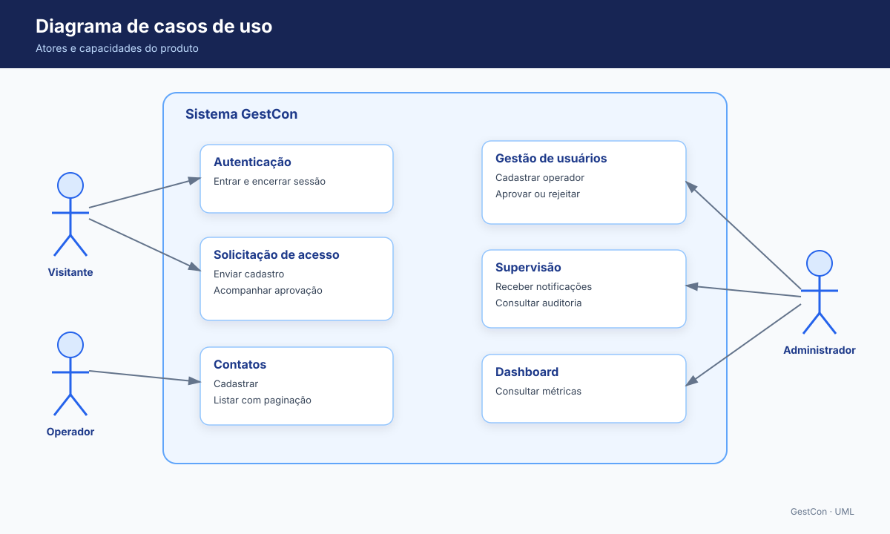
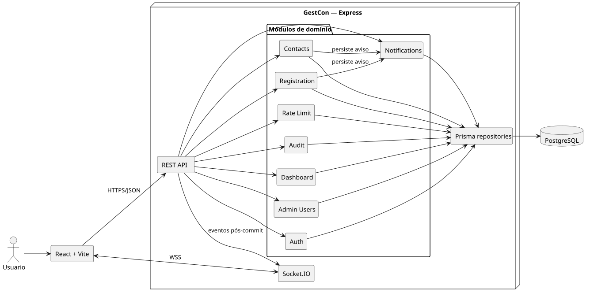
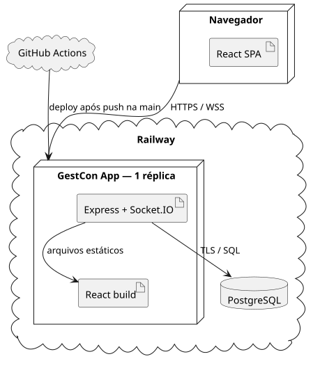
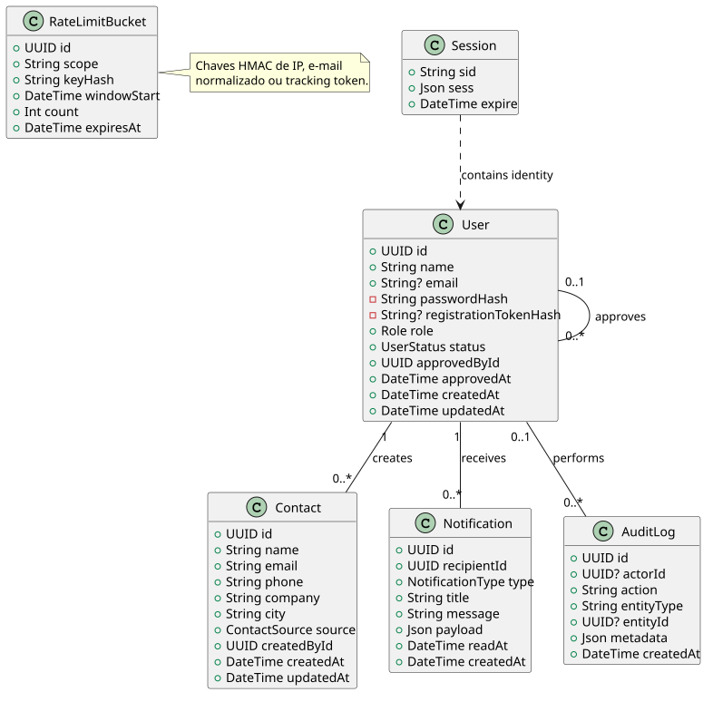
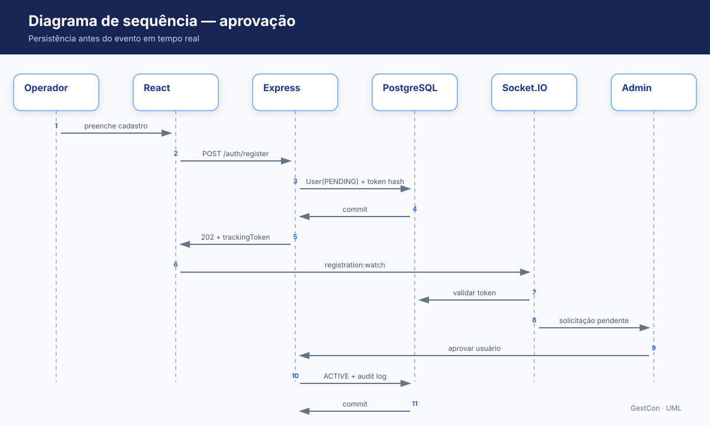
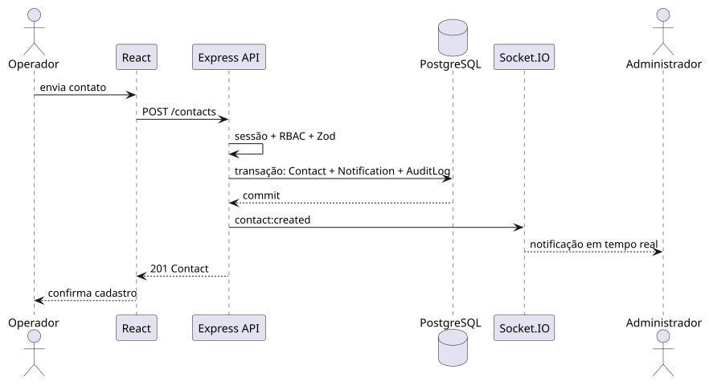
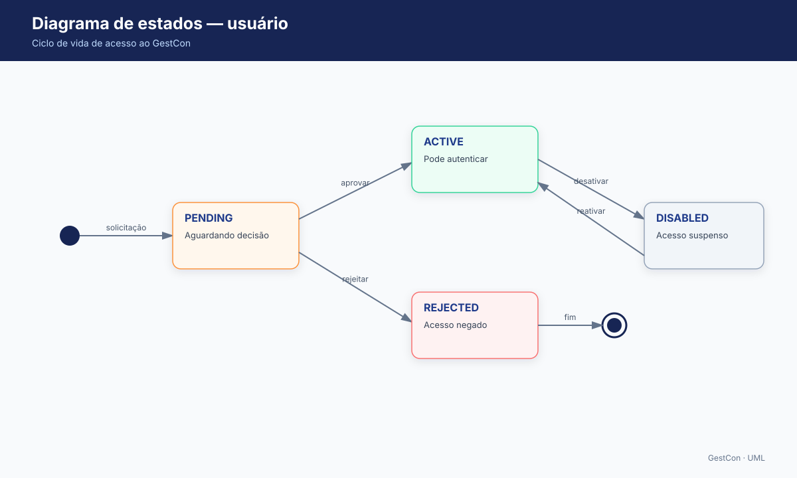

# Documentação UML

Os diagramas abaixo descrevem o sistema sob perspectivas complementares. As fontes PlantUML ficam em `docs/uml/`; os arquivos SVG gerados ficam em `docs/assets/uml/`.

## Casos de uso

Define responsabilidades de visitante, operador e administrador.

## Componentes

Mostra o monólito modular e as relações entre interface, API, tempo real, módulos e persistência.

## Implantação

Representa a topologia inicial no Railway com uma instância da aplicação e PostgreSQL.

## Classes do domínio

Resume entidades persistidas e seus relacionamentos principais, incluindo sessões e buckets do rate limiter. O schema Prisma final deve manter equivalência conceitual.

## Sequência de aprovação

O tracking token autoriza somente o acompanhamento da solicitação. A aprovação é persistida antes do evento.

## Sequência de criação de contato

Contato, notificação e auditoria são confirmados antes da publicação do evento.

## Estados do usuário

Somente usuários `ACTIVE` podem autenticar e operar a aplicação.

## Atualização dos diagramas

Ao alterar entidades, módulos ou fluxos:

1. Atualize o `.puml` correspondente.
2. Regenere o SVG.
3. Confira legibilidade e consistência com requisitos e ADRs.
4. Versione fonte e imagem juntas.

